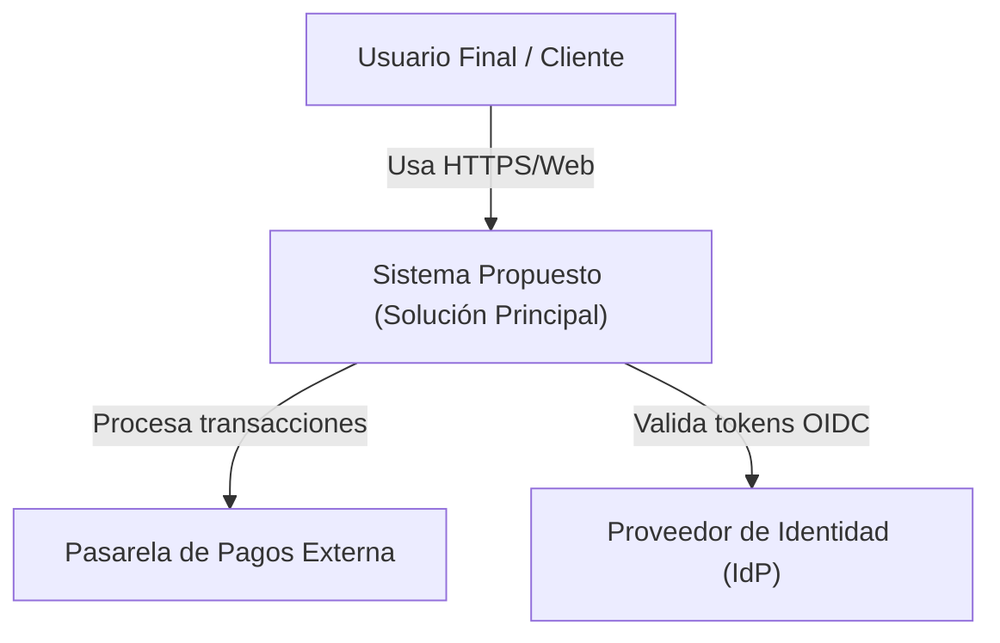
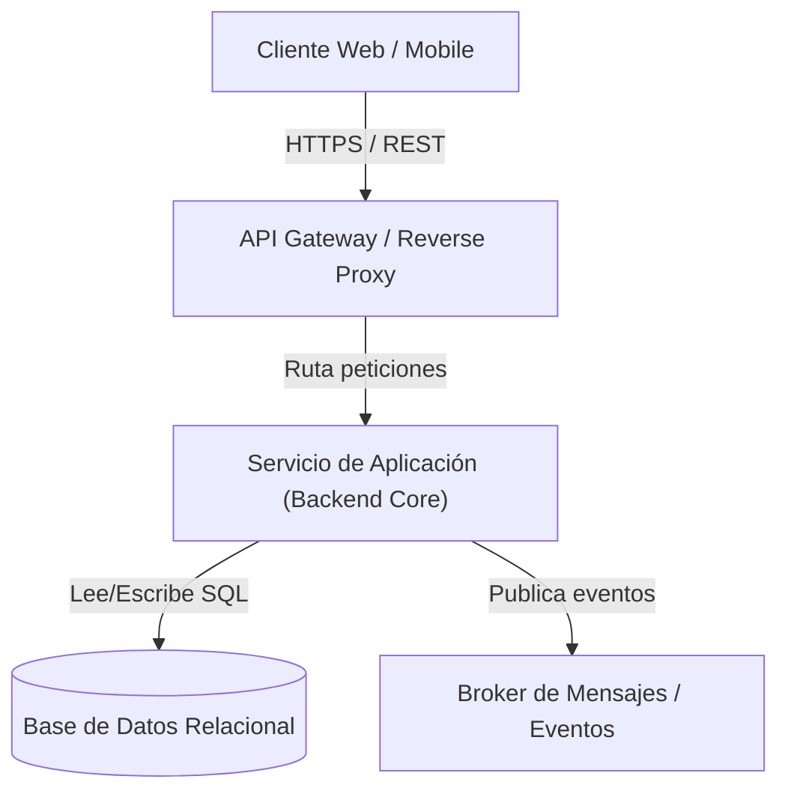
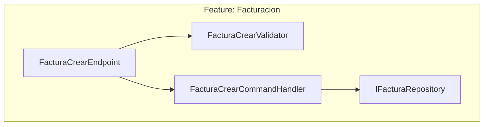

# arquitectura-agnostica — Metodología de Diseño Agnóstico y Selección de Stacks

Esta habilidad guía el diseño de sistemas de software desde una perspectiva estrictamente desacoplada del lenguaje o framework subyacente, asegurando que las decisiones arquitectónicas respondan a atributos de calidad y reglas del dominio antes de comprometerse con una tecnología específica.

---

## 1. Principios del Diseño Agnóstico

1. **Separación entre Intención y Mecanismo**:
   - Modelar las capacidades del sistema, los límites de contexto (*Bounded Contexts*) y los contratos de datos sin asumir características propietarias de ningún lenguaje.
   - Definir interfaces de comunicación (síncronas vía HTTP/REST/gRPC o asíncronas vía eventos/mensajería) mediante especificaciones abiertas (OpenAPI, AsyncAPI, JSON Schema).

2. **Modelado de Dominio de Negocio**:
   - Mapear las entidades centrales, casos de uso, eventos del dominio y políticas de negocio.
   - Utilizar terminología de negocio en español claro y consistente.

3. **Definición de Atributos de Calidad (NFRs)**:
   - Cuantificar expectativas de desempeño (latencia p95/p99, throughput/TPS).
   - Definir metas de disponibilidad (99.9%, 99.99%), resiliencia (RPO, RTO) y elasticidad de carga.

---

## 2. Protocolo de Recomendación Tecnológica (Matriz Multicriterio)

Al evaluar el stack de implementación para una solución, siempre se deben presentar **3 opciones con perfiles marcadamente diferenciados**, acompañadas de la posibilidad de que el usuario proponga una diferente:

| Perfil de Opción | Ejemplos Representativos | Fortalezas Clave | Casos de Uso Típicos |
|---|---|---|---|
| **Opción 1: Enterprise Robusto** | C# (.NET 8+), Java (Spring Boot 3 / Quarkus) | Tipado fuerte estricto, tooling empresarial maduro, soporte corporativo de largo plazo, robustez en concurrencia. | Aplicaciones corporativas de misión crítica, integración con bases de datos relacionales complejas, sistemas financieros. |
| **Opción 2: Cloud-Native / Alto Rendimiento** | Go, Rust | Binarios estáticos ultraligeros, consumo mínimo de memoria RAM, arranque instantáneo (<10ms), alta concurrencia nativa. | Microservicios distribuidos, APIs de alta tasa de peticiones (high throughput), pasarelas API, procesamiento en tiempo real. |
| **Opción 3: Agilidad y Time-to-Market** | TypeScript (Node.js / NestJS / Fastify), Python (FastAPI) | Ecosistema masivo de librerías, velocidad de prototipado, unificación de lenguaje frontend/backend (en TS), adopción generalizada. | Startups, MVPs, plataformas con cambios rápidos de requerimientos, integraciones con IA y APIs externas. |
| **Opción 4: Personalizada** | A definir por el usuario | Selección guiada por restricciones o estándares vigentes de la organización. | Proyectos con infraestructura preexistente o licencias específicas. |

### Criterios de Evaluación Obligatorios

Cada una de las 3 opciones debe evaluarse y puntuarse (Alta / Media / Baja o escala 1 a 5) en los siguientes 4 ejes:

1. **Curva de Aprendizaje y Disponibilidad de Talento**: Facilidad de incorporación de desarrolladores y disponibilidad de talento en el mercado.
2. **Madurez del Ecosistema y Comunidad**: Calidad del gestor de paquetes, disponibilidad de librerías seguras y frecuencia de mantenimiento.
3. **Postura de Seguridad y Mantenibilidad**: Frecuencia de parches de seguridad, tooling de análisis estático integrado (SAST/SCA) y soporte LTS oficial.
4. **Footprint y Costos de Infraestructura**: Consumo de CPU/memoria en reposo y bajo carga, tiempo de inicio en contenedores (cold starts) y costo operativo en la nube.

---

## 3. Diagramación C4 en Mermaid

Todo diseño agnóstico debe acompañarse de diagramas C4 embebidos usando sintaxis de bloques `mermaid`:

### Nivel 1: Diagrama de Contexto del Sistema



### Nivel 2: Diagrama de Contenedores



### Nivel 3: Diagrama de Componentes (Vertical Slice)



---

## 4. Registro de Decisiones de Arquitectura (ADR)

Toda decisión arquitectónica relevante (selección de stack, adopción de estilos arquitectónicos, descarte de alternativas) debe documentarse en `docs/arquitectura/adr/` siguiendo el formato estandarizado:

```markdown
# ADR-000X: [Título Breve y Descriptivo]

- **Fecha**: AAAA-MM-DD
- **Estado**: Propuesto | Aceptado | Reemplazado
- **Autor(es)**: softeng / [Nombre del Usuario]

## Contexto y Declaración del Problema
Descripción del problema de negocio o técnico que motiva la decisión y las restricciones existentes.

## Opciones Consideradas
1. Opción A: [Ventajas y Desventajas]
2. Opción B: [Ventajas y Desventajas]
3. Opción C: [Ventajas y Desventajas]

## Decisión Adoptada
Elección realizada con su justificación técnica directa basada en atributos de calidad.

## Consecuencias
- **Positivas**: Beneficios directos esperados.
- **Negativas / Riesgos**: Sobrecargas, deuda técnica asumida o mitigaciones requeridas.
```

